# Darksight

**Where and when can we land on the Moon, with sunlight for power and a line to Earth for radio?**

Darksight compares lunar landing sites and dates side by side, measured against the real terrain
skyline from NASA's LRO LOLA height maps. It runs in any browser, with no install and no account.

**▶ Try it: [darksight.space](https://darksight.space)** · Mirror:
[rickphobia.com/projects/darksight](https://rickphobia.com/projects/darksight/) ·
[Demo video (30 s)](https://drive.google.com/file/d/1BNsboqQI9dvgL6qAwDgmxr1zFZH-55Px/view) ·
[Slides (PDF)](pitch/darksight-slides.pdf)

Team GLYFT, Kuala Lumpur. [NASA Space Apps Challenge 2026: Lunar Landing Site Navigator](https://www.spaceappschallenge.org/2026/challenges/lunar-landing-site-navigator/).

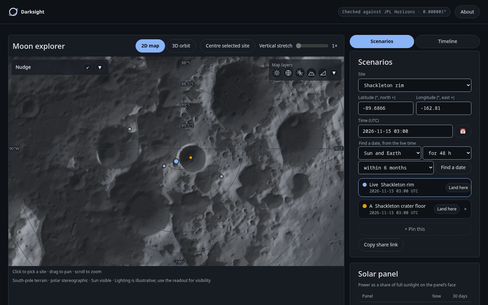

## The problem, in one example

At the lunar south pole the Sun skims the horizon, so a single ridge can hide it for days.
On 15 Nov 2026 at 03:00 UTC:

| | Shackleton rim | Crater floor, about 11 km away | 1 km north of the rim |
|---|---|---|---|
| Lit, next 30 days | **100.0 %** | **0.0 %**, permanently shadowed until 2100 | **17 days less sunlight** |
| Earth in view, next 30 days | 42.9 % | 0.0 % | Earth never visible |

Landing sites are chosen to the kilometre and launch dates slip by days. Checking a slip by hand
takes about an hour across three tools. In Darksight it takes a click.

## What you can do

### Compare sites and dates side by side

Pin up to three scenarios (site and time). The compare table gives the share of the next 30 days
in sunlight and in contact with Earth, the countdown to the next sunset or Earthrise, and the
longest light, darkness and contact gap. The best value in each row is marked. The strips under
the table show when the Sun and Earth are up over the next 30 days, one row each.

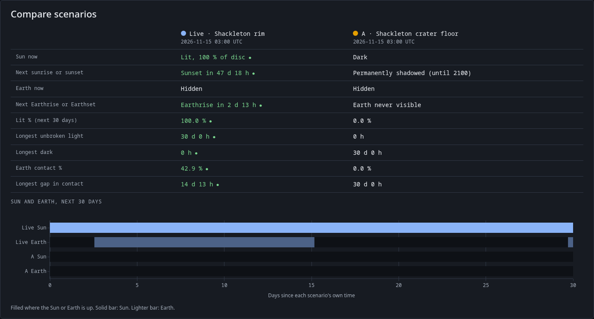

### Pick any site on the Moon

Click the map, pick one of 24 curated sites (the Apollo landings, Chang'e 4 to 6, Chandrayaan-3,
SLIM, IM-1 and IM-2, Blue Ghost, south-pole candidates, and four upcoming mission targets), or type
a latitude and longitude. Choose any time from 1900 to 2100. The page address holds the whole
comparison, so "Copy share link" reopens exactly the same view.

<p>
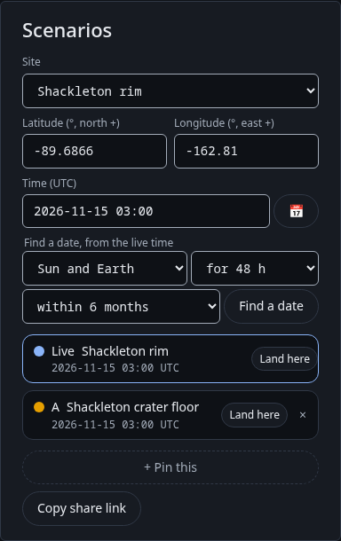
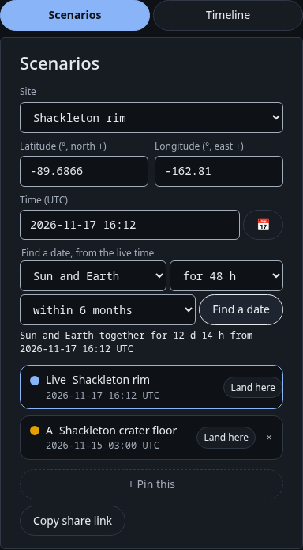
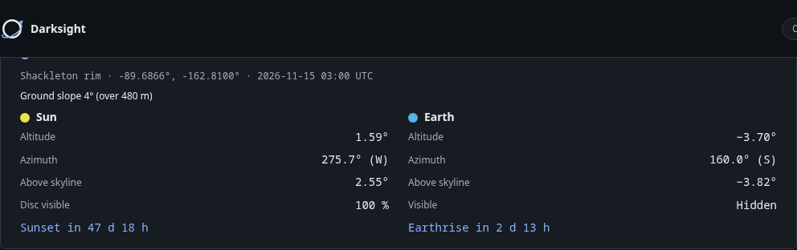
</p>

- **Readout**: the Sun's and Earth's altitude and azimuth, how far each is above the terrain
  skyline, how much of the Sun's disc shows, the ground slope, and countdowns such as
  "Sunset in 47 d 18 h" or "Permanently shadowed (until 2100)".
- **Find a date**: the first time, from the live time, with sunlight and/or Earth for at least
  24 h to 7 days, searched up to 12 months ahead.

### The nudge: 1 km changes everything

Move the site 1 km (0.1 to 10 km) north, south, east or west, one day earlier or later, or to a pole.
The site moves at once, its old place stays on the map in grey, and the panel says in words what
changed. Undo puts it back.

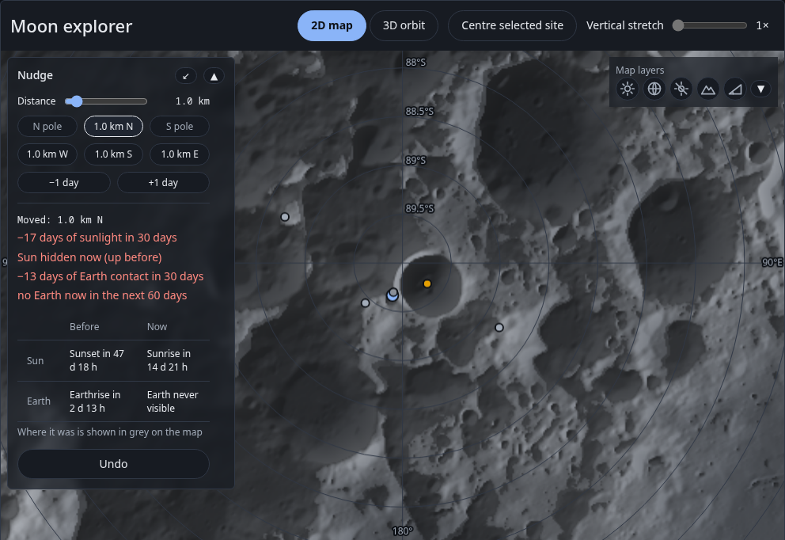

### See it on the map, in 3D and in the sky

<p>
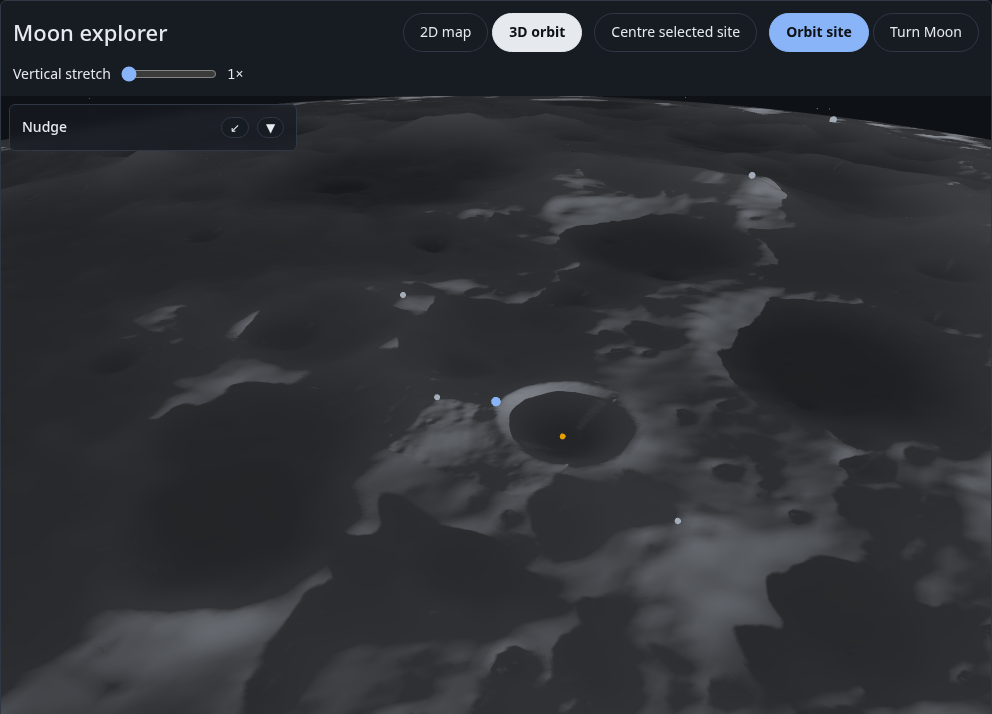
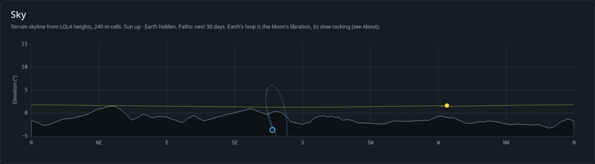
</p>

- **2D map and 3D orbit view** of the real LOLA terrain, lit by the Sun at the chosen time, with
  a cross-fade between them.
- **Sky panorama**: the terrain skyline all the way round the site, with the Sun's and Earth's
  paths over the next 30 days. Earth's small loop is the Moon's libration.
- **Timeline**: degrees above the skyline over 30 days, 90 days or a year. Click or drag on it to set the time.

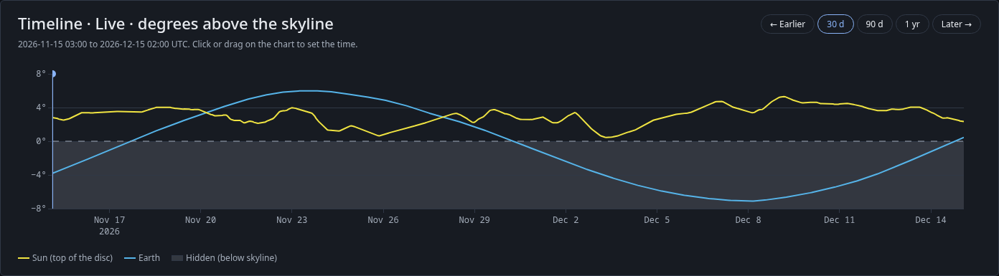

### Map layers over the whole Moon

Average sunlight, Earth in view, permanent shadow ("never lit"), height and slope. Near both poles
the layers use LOLA's illumination maps with terrain; elsewhere our own smooth-Moon averages. The
map says which source applies at each point.

<p>
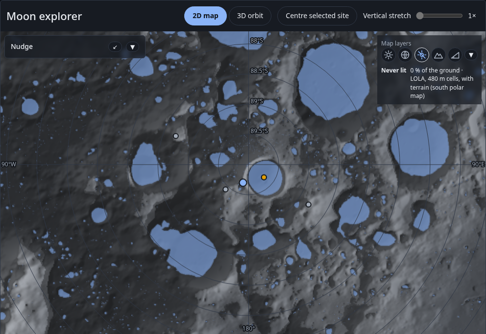
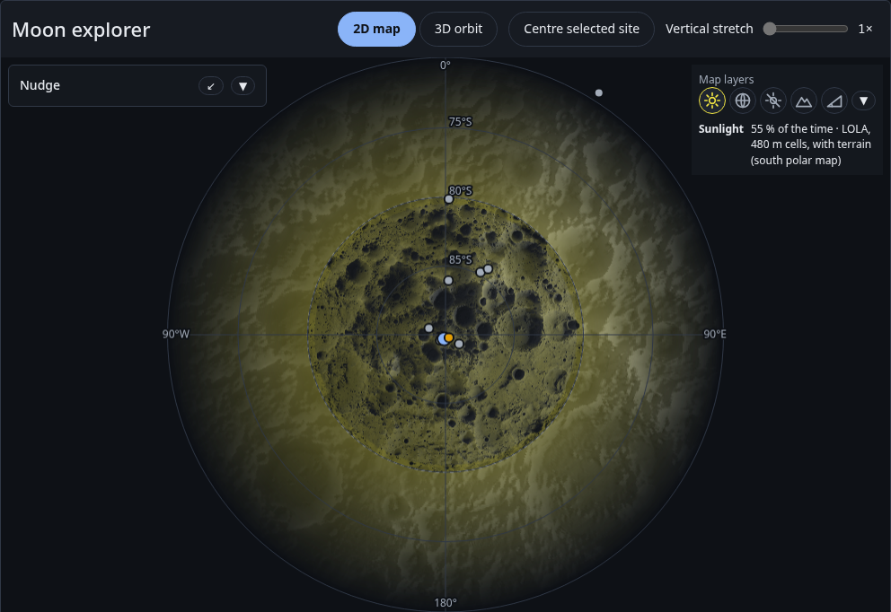
</p>

### Power: solar panel, battery and playback

The solar panel card compares a flat panel with an upright one turned to the Sun (3 % against
100 % on the Shackleton rim), and runs a battery through the next 30 days. The Timeline tab plays
the scenario forward. The map, strips, chart and sky follow it, with a live battery charge and
radio link.

<p>
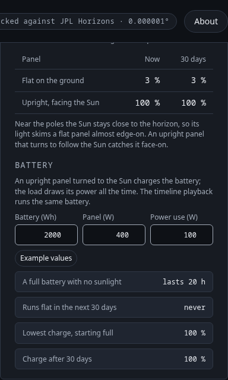
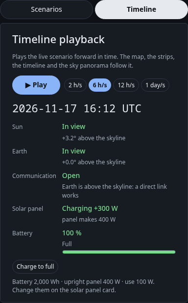
</p>

### Plan the flight: mission, launch simulation, report

"Land here" on a scenario, then "Open mission", plans a flight from one of 19 launch pads on Earth
to touchdown at the chosen site and time. It covers ascent, translunar injection, lunar orbit and
powered descent, with Δv and propellant for an editable lander. Darksight is a planning model, not a
flight-dynamics solution, and the page says so. "Proceed" plays the whole flight in 3D.
"Generate full launch schedule" makes a report to print, save as PDF, or download as JSON and CSV.

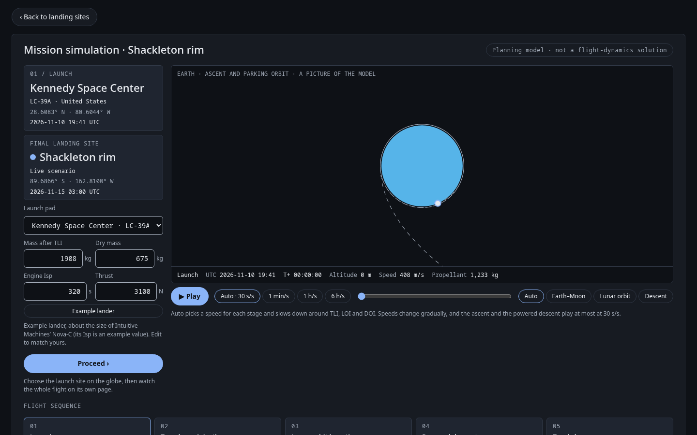

<p>
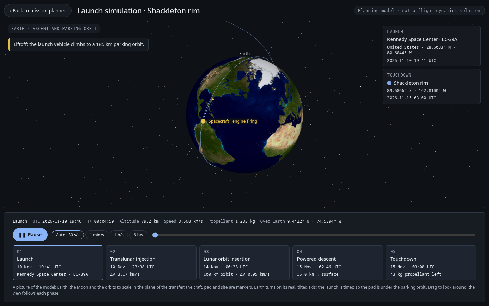
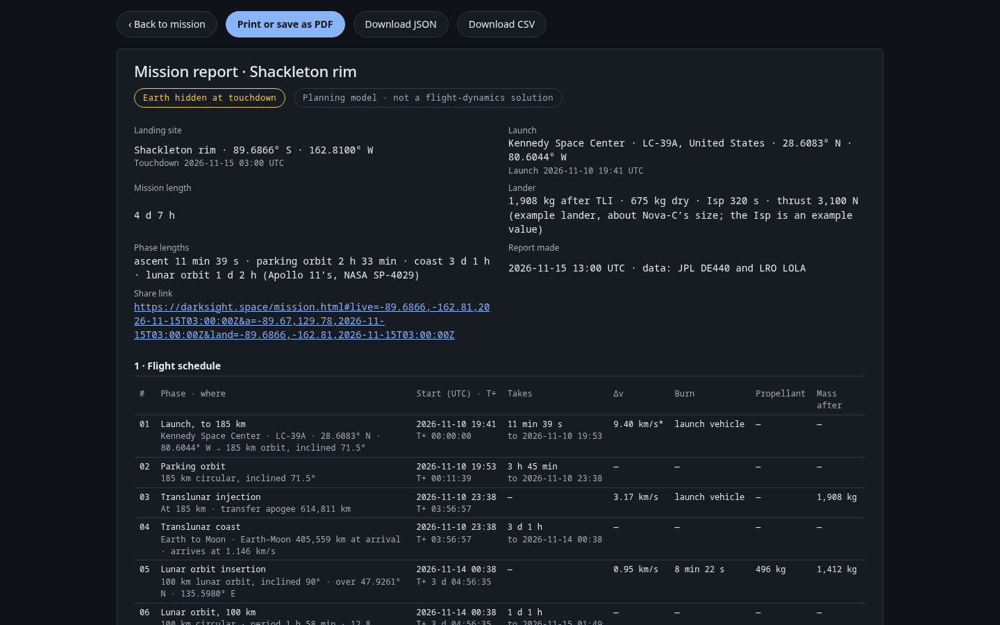
</p>

### Learn why the Moon is different

The About panel explains, in plain words, why a lunar day lasts a month, why there is no twilight,
and why the Sun stays low at the poles. Each point links to the part of the page that shows it. The
panel also lists the known limits and every source.

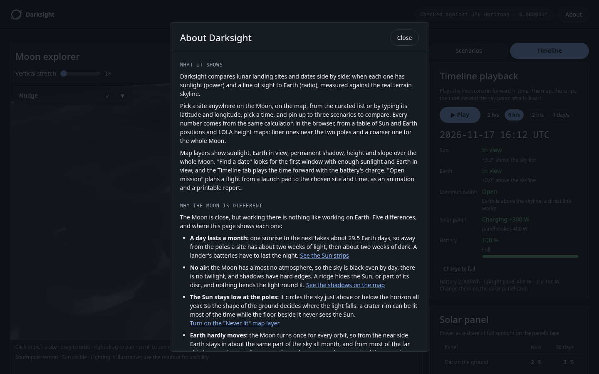

## Why you can trust the numbers

- **Checked against NASA JPL Horizons.** 18 cases (Sun and Earth, several sites and times) with a
  tolerance of 0.1°. The largest difference is **0.000001°**
  ([`web/public/data/validation.json`](web/public/data/validation.json)). The badge at the top of
  every page shows it, and a test repeats the comparison on every change.
- **Real terrain.** The skyline is traced 150 km out in every direction from LOLA heights: 240 m
  cells near the south pole, 1.2 km near the north pole, 3.8 km elsewhere. The Moon has no atmosphere, so no refraction is applied.
- **Terrain tests on the real data.** The Shackleton crater floor is never lit up to 2100, and a
  rim point is lit more than half the time.
- **840 automated tests** (Vitest) and a browser smoke test (Playwright) run in CI on every pull request.
- **Every number comes from one place.** All the maths is in [`web/src/core/`](web/src/core),
  pure functions with tests. The map, 3D scene and charts only draw what `core/` returns.
- **Known limits are stated** in the About panel: terrain resolution, the 150 km skyline, Earth
  treated as a point, and the mission planner being a model.

## How it works

```
data-prep/ (Python, run once)                 web/ (TypeScript, in the browser)
  Skyfield + JPL DE440  ──▶ Sun & Earth table   ──▶  core/: angles, skyline, countdowns, %
  LRO LOLA height maps  ──▶ dem.bin, globe.bin  ──▶  UI: map, 3D, charts, compare, mission
```

At any moment the directions of the Sun and Earth from the Moon are the same for every site.
Only each site's local "up" differs. So one table, every 3 hours from 1900 to 2100, serves every
site, and the browser works out the rest. There is no server, database or account. The site is
static files on Cloudflare Pages.

**Built with:** TypeScript, Vite, three.js, Plotly.js · Python, Skyfield, NumPy, Pillow ·
Vitest, Playwright · GitHub Actions, Cloudflare Pages.

## NASA data

- **LRO LOLA height maps**: LDEM_75S_240M, LDEM_75N_240M, LDEM_16, LDEM_64 (PDS Geosciences Node).
- **LRO LOLA illumination maps**: average Sun and Earth visibility and permanent shadow for both
  poles (NASA GSFC Planetary Geodesy Data Archive).
- **NASA JPL ephemerides DE440 and DE421** and **NAIF lunar kernels**, through Skyfield.
- **NASA JPL Horizons API**, for the independent check.
- **NSSDCA** and **LROC** (NASA/GSFC/ASU), for landing-site positions. **NASA Blue Marble**, for Earth.
  **NASA SP-4029**, for the Apollo 11 timeline used by the mission planner.

All 307 sources, each with a link and licence: [`pitch/references.md`](pitch/references.md).

## How we used AI

We built Darksight with AI coding assistants, mainly Claude Code, plus OpenAI Codex, ChatGPT and
Gemini for smaller parts. The team chose the idea, the challenge, the features and the design.
AI wrote most of the code, tests and documentation. A team member checked every piece with tests,
by reading it, against NASA tools (JPL Horizons, LROC QuickMap) or in the browser. Every task
keeps a public record of what the AI generated and what a person checked, in
[`docs/ai-use/`](docs/ai-use). The summary is in [`pitch/ai-use.md`](pitch/ai-use.md). No image,
video or audio was generated by AI.

## Run it yourself

Needs Node 22 or newer (`web/.nvmrc`). The data files are committed, so a fresh clone works.

```
cd web
npm ci
npm run dev      # the site, on your own machine
npm test         # every test, once
npm run build    # type-check, then build into web/dist/
```

The README screenshots come from `node docs/screenshots/take-screenshots.mjs`, run from the repo
root after `npm ci` in `web/`.

## Team GLYFT

Go Yu An · Leon Ng · Yeap Yi Hung · Fabian Chuah · Teh Hao Zhe

Code under the [MIT License](LICENSE). The lunar data comes from NASA and is in the public domain.

---

## For the team: where things are

<details>
<summary>Repo map (how this 48-hour, five-person build was coordinated)</summary>

| File | What it's for | Who reads it |
|---|---|---|
| `SPEC.md` | What we build, what's cut, when it's due | Everyone, once |
| `CLAUDE.md` | Rules every Claude session follows in this repo | Loaded automatically by Claude Code |
| `docs/data-contract.md` | File formats and function names both halves follow | Everyone, before writing code |
| `docs/team-workflow.md` | How to take a task: branch, Claude, pull request | Everyone, once |
| `tasks/README.md` | Shared task queue, priorities and dependencies; anyone can claim a task | Everyone, often |
| `tasks/Txx-*.md` | One task each, with scope, status and "done when" tests | Whoever takes the task |
| `docs/ai-use/` | One file per task: how AI was used (the submission needs this) | The task's contributors |
| `docs/sources/` | One file per task: every data source and library used | The task's contributors |
| `docs/decisions.md` | Decisions and why | Anyone records an agreed decision |
| `history.md` | What a rule or fact used to say, and why it changed | Read before changing a rule |
| `docs/design.md`, `docs/design/` | The look: palette, type, one picture per part of the screen | Everyone building a UI module |
| `docs/mcp-and-skills.md` | Which MCP servers and skills each person installs; the Figma rules | Everyone, once; the UI designer closely |
| `qa/` | Testing with real people at each milestone, and the bug lists | Anyone fixing bugs |
| `pitch/` | Slides, demo video, submission text, references | Whoever completes T17 |
| `workflow-audit.md` | A dated audit of this workflow and what was done about each finding | Nobody needs to; it's a record |

```
data-prep/         Python, run once on a laptop. Makes the data files.
web/               The site: Vite + TypeScript + three.js + Plotly.js. No server.
web/public/data/   Output of data-prep. Committed, so the site works from a fresh clone.
```

Hackathon rules that bind this repo: public repo, MIT licence; every data source and library is
cited (`docs/sources/`); the submission describes how AI tools were used (`docs/ai-use/`).

</details>
